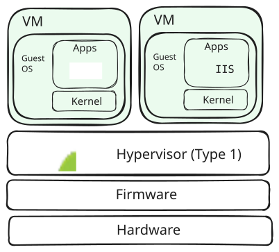
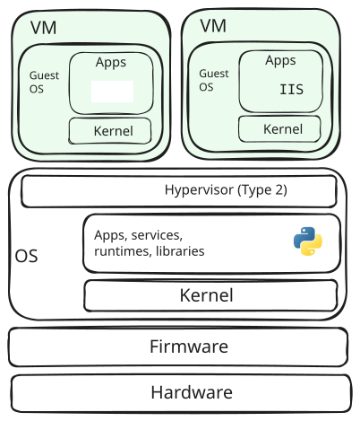
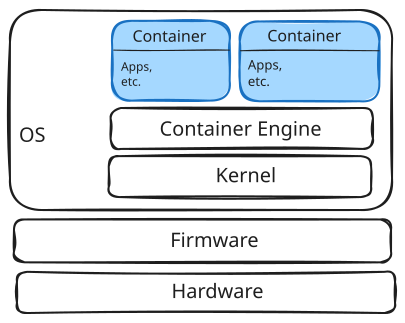
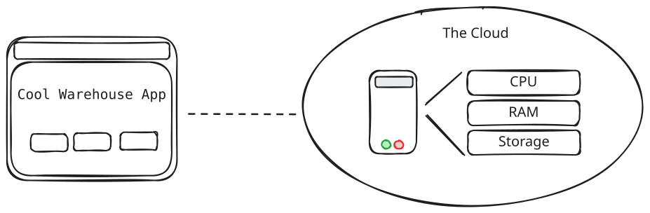
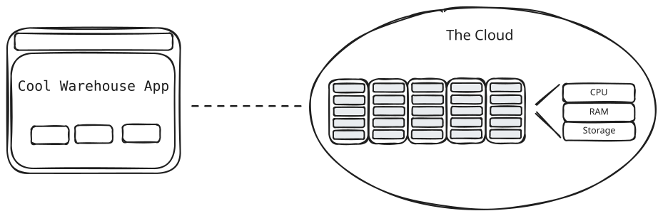
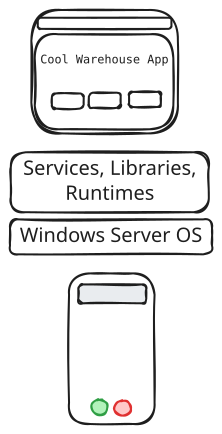
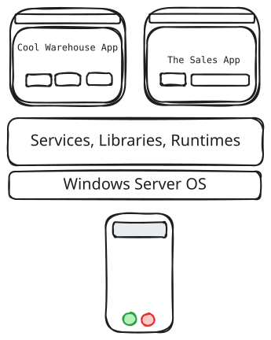
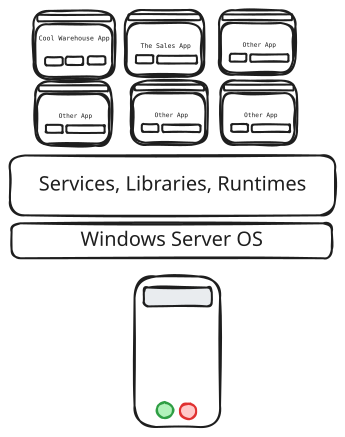
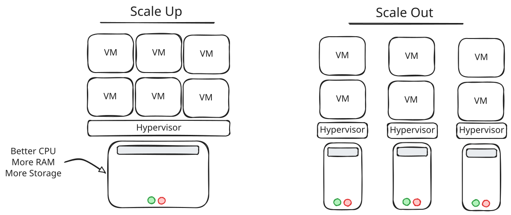
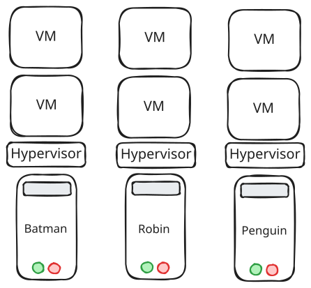

::slide{.title}

# Docker

---

::slide{.section}

# Review

---

## Hypervisor

Allows multiple guest operating systems to run on the same physical hardware.

- Also called a _virtual machine monitor_ (VMM)
- Two types of hypervisors: Type 1 (bare metal) and Type 2 (hosted)

::::columns

:::fill{.center style="width: 60%"}

:::

:::fill{.center style="width: 80%"}

:::

::::

:::notes
The hypervisor provides illusions to guest operating systems in much the same way that an individual operating system provides illusions to its processes.

- The guest operating systems behave just like they would if used without a hypervisor.
- Each guest has its own kernel, process scheduling, virtual memory management, etc.
  :::

---

## Virtual Machine Uses

:::steps

- **Experimentation**: try out another OS without removing your current one
- **Compatibility**: run apps that only work on certain OSes
- **Isolation**: sandbox apps to specific virtual environments
- **Consolidation**: host multiple virtual servers on a single physical machine
- **Development/Testing**: ensure correct environment for dev/QA
- **Snapshots**: save VM state, experiment, rollback to saved state
- Many more...
  :::

:::bottom{.step}
Drawbacks? Do you need the entire OS?
:::

:::notes
There are lots of use cases where virtual machines are great. Some uses of virtual machines can be overkill. If you want to isolate an application into its own environment, with just the dependencies it needs, an entire OS may not be necessary.

An OS in a virtual machine has all the mechanisms of that OS and its kernel: process scheduling, virtual memory management, boot sequences, drivers, etc. This may not be necessary depending on the use case.
:::

---

## Containers

- Package specific applications along with dependent libraries and system files
- Run isolated on a host system
- Use the host system's kernel
- Host system provides illusions to container with minimal overhead

:::fill{.center style="width: 80%"}

:::

:::notes
Containers don't need a full OS install. They do not have their own kernels, unlike an OS installed in a virtual machine. Certain system files and libraries may be included inside the container which may give the appearance of a certain guest OS being used.
:::

---

::slide{.section}

# Evolution

From pets to cattle

:::notes
"Pets to cattle" will make sense shortly.
:::

---

## Cloud

:::fill{.center style="width: 80%"}

:::

:::notes
If you create a new app, you probably think _I'll put it in the cloud_. You can think of "the cloud" as a computer somewhere in a land far, far away that is running your code and providing it to the Web.
:::

---

## Cloud

:::fill{.center style="width: 80%"}

:::

:::notes
More likely: your code is using some slice of CPU, memory, and storage from a massive number of computers running in a datacenter somewhere. Regardless, in many cases, the details are abstracted away. There are popular providers like [Vercel](https://vercel.com) and [Netlify](https://www.netlify.com/) that make it very easy to deploy and run a web application without knowing about the underlying infrastructure.

:::

---

## Single Physical Server

::::columns

:::fill{.step .center style="width: 60%"}

:::

:::fill{.step .center style="width: 85%"}

:::

:::fill{.step .center style="width: 85%"}

:::

::::

:::notes

:::

---

## Scale

:::fill{.center style="width: 100%"}

:::

:::notes

:::

---

## Multiple Servers

:::fill{.center style="width: 100%"}

:::

:::notes

:::

---

## Pets vs Cattle

Treat your infrastructure like cattle, not pets.

:::fill

> In the old way of doing things, we treat our servers like pets, for example Bob the mail server. If Bob goes down, it’s all hands on deck. The CEO can’t get his email and it’s the end of the world. In the new way, servers are numbered, like cattle in a herd. For example, www001 to www100. When one server goes down, it’s taken out back, shot, and replaced on the line.
> :::

:::bottom{.small}
[The History of Pets vs Cattle and How to Use the Analogy Properly](https://cloudscaling.com/blog/cloud-computing/the-history-of-pets-vs-cattle/)
:::

:::notes

:::

---

## Automation

- [Puppet](<https://en.wikipedia.org/wiki/Puppet_(software)>) - software configuration management tool (not just for VMs)
- [Vagrant](https://developer.hashicorp.com/vagrant) - more for development environments than servers

:::notes

:::

---

## Containers

- Package application + required dependencies
- Create/destroy containers as needed
- Minimal overhead per container
- Easily portable across servers and workstations
- Developers get identical environment as production

:::notes

:::

---

::slide{.section}

# Docker

---

## Image

To create a container, you need a container _image_.

Analogy:

- A process is an instance of a program.
- A container is an instance of an image.

Images:

- contain a base layer of necessary system files, libraries, and dependencies.
- contain application code and supporting files needed to run that app.
- do not have their own kernel.
- are immutable.

---

## Run

To use Docker:

- Install the Docker engine on your host OS
- Find an image to use from a registry like [Docker Hub](https://hub.docker.com/), or create your own image
- Run: `docker run <image-name>

Example of running a container:

```
docker run hello-world
```

:::bottom{.small}
Note: you may have to prefix certain Docker commands with `sudo` in the lecture Codespace.
:::

---

## List Containers

To list running containers:

```
docker ps
```

To list all containers:

```
docker ps -a
```

To delete a container:

```
docker rm <container_name_or_id>
```

---

## Example: Web Application

Simple web application test image: [crccheck/hello-world](https://hub.docker.com/r/crccheck/hello-world)

```
docker run -d --name web-test -p 8888:8000 crccheck/hello-world
```

- `docker run`: creates a new container
- `-d`: runs in detached mode; lets the container run in the background
- `--name`: assign a custom name to the container instead of a randomly generated one
- `-p 8888:8000`: maps the port 8888 on the host machine to go to port 8000 inside the container
- `crccheck/hello-world`: the image to use for this container

:::notes
If running this in a Codespace, you'll need to forward port 8888 in order to view the application in your browser. Use the **Ports** tab in your Codespace instance to do this.
:::

---

## Example: (cont)

Stop a running container:

```
docker stop <name_or_id>
```

Restart a stopped container:

```
docker start <name_or_id>
```

---

## Example: Fedora

Many base images exist for different OS distributions.

Here is an example for Fedora:

```
docker run -it --rm fedora:44 bash
```

- `-it`: run in interactive mode; keep stdin open and fed into the container from host
- `--rm`: delete the container automatically after it exits
- `fedora:44`: run the `fedora` image using the version tagged `44`
- `bash`: run the bash command inside the container after it starts; this will launch a shell for us to use inside the container

---

## Persistence

- Containers are intended to be created, destroyed, recreated, etc.
- Changes inside a container are lost.
- For persistence: use volumes or bind mounts

---

## Example: Bind Mount

Run without mounting a volume:

```
docker run -d -p 8080:80 nginx:alpine
```

Run with container's `html` folder mounted to host file system:

```
docker run -d -p 8080:80 -v "$(pwd)/mysite":/usr/share/nginx/html nginx:alpine
```

- `-v "$(pwd)/mysite":/usr/share/nginx/html`
- Host directory is on left of `:`
- Container directory is on right
- `$(pwd)` gets the current working directory of your shell

---

## Example: Volume

Run with container's `html` folder mounted to a named volume:

```
docker run -d -p 8080:80 -v myvol:/usr/share/nginx/html nginx:alpine
```

List volumes:

```
docker volume ls
```

---

## Example: Custom Image

https://github.com/eu-cpsc415/devcontainer-qemu-riscv

---

## Docker Compose

- Define a collection of containers to run together (e.g., web app + database)
- Containers defined in `docker-compose.yaml`
- Run `docker compose up -d` to start the stack
  - Run in same directory as `docker-compose.yaml`
- Run `docker compose down` to stop the stack

---

## Exercise

See instructions in lecture repo.
